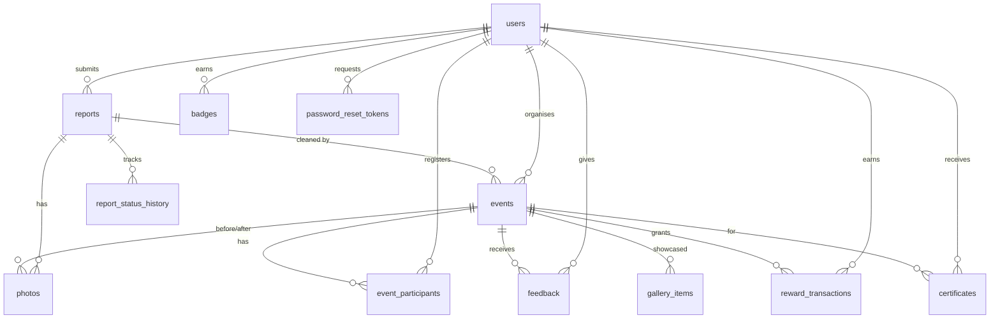

# Database schema — `community_cleanup`

Managed by Flyway (`backend/src/main/resources/db/migration`). The seven core tables follow the project ER diagram;
five supporting tables implement rewards, certificates, gallery, audit history and password reset.

## Core tables
| Table | Key columns | Constraints |
|---|---|---|
| `users` | user_id, name, email, password (BCrypt), role, phone, organization_name, points, active, created_at, updated_at | `email` unique; role ∈ RESIDENT/VOLUNTEER/NGO/ADMIN |
| `reports` | report_id, user_id, title, description, location, latitude, longitude, waste_type, urgency, status, admin_comment, created_date, updated_date | FK user_id → users |
| `events` | event_id, created_by, related_report_id, title, description, event_date, start_time, end_time, location, latitude, longitude, volunteers_required, status, created_at, updated_at | FK created_by → users, related_report_id → reports; volunteers_required > 0 |
| `event_participants` | participant_id, event_id, user_id, registration_date, attendance (default false) | unique (event_id, user_id) |
| `photos` | photo_id, report_id, event_id, photo_url, public_id, photo_type (REPORT/BEFORE/AFTER), uploaded_by, uploaded_date | image binaries are **not** stored — only Cloudinary URL + public id |
| `badges` | badge_id, user_id, badge_name, awarded_date | unique (user_id, badge_name) — no duplicate badges |
| `feedback` | feedback_id, user_id, event_id, rating, comments, submitted_date | unique (user_id, event_id); rating 1–5 |

## Supporting tables
| Table | Purpose |
|---|---|
| `reward_transactions` | Points ledger; unique (user_id, event_id, reason) prevents double awards. `users.points` is the denormalised total used by the leaderboard. |
| `certificates` | One per (user, event); `certificate_number` is public and verifiable. PDFs are generated on demand. |
| `gallery_items` | Before/after image URLs, location, completion date, `approved` flag for moderation. |
| `report_status_history` | Every status change: old/new status, changed_by, comment, changed_at. Drives the timeline UI. |
| `password_reset_tokens` | SHA-256 hash of the emailed token, expiry, used flag. |

Enumerations are stored as `VARCHAR` (Hibernate `EnumType.STRING`) so values stay readable and new values do not
require renumbering.
